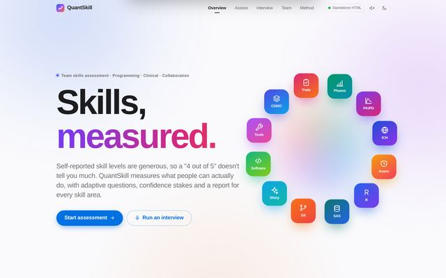
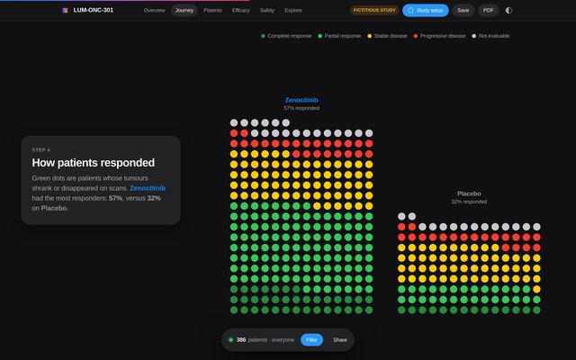
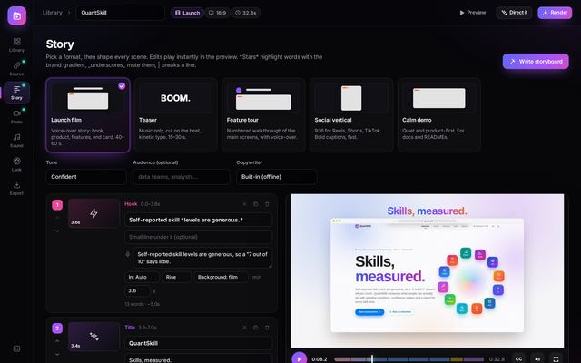
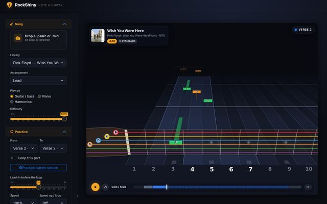
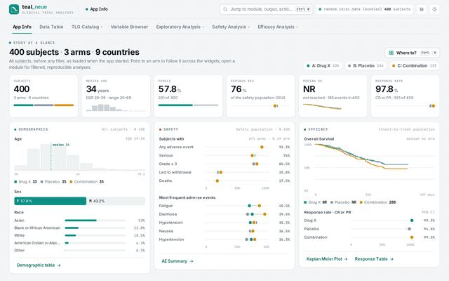
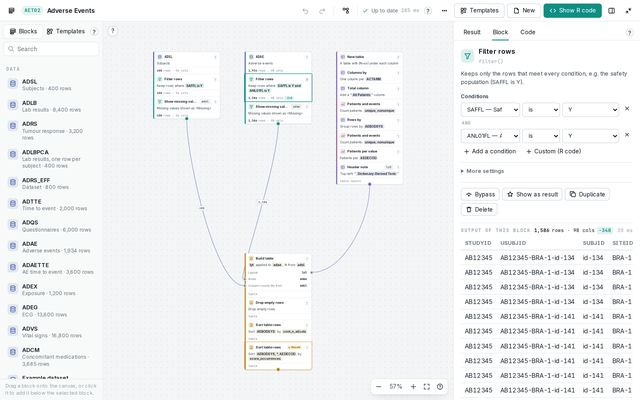
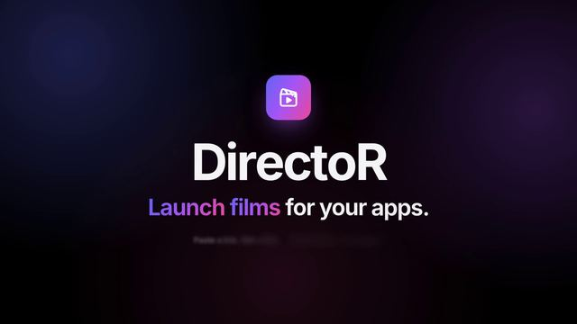

# taiga: the Taiga design system for Shiny, Quarto and HTML

**taiga** is an R package. It holds the design system of six Taiga applications, in two frameworks:

| Framework | Voice | Applications | Guides |
|---|---|---|---|
| **Lumen** | Cinematic, high-contrast, glass-driven | QuantSkill · lumenJourney · DirectoR · RockShiny | [styleguide](inst/guides/lumen/STYLEGUIDE.md) · [requirements](inst/guides/lumen/REQUIREMENTS.md) |
| **Neue** | Minimalist, high-density enterprise | teal_neue · BlockR | [styleguide](inst/guides/neue/STYLEGUIDE.md) · [requirements](inst/guides/neue/REQUIREMENTS.md) |

Every Taiga project ships one front end three ways, as a Shiny app, a Quarto document and a standalone
HTML file: the [delivery model](inst/guides/DELIVERY_MODEL.md).

| | | |
|---|---|---|
| [](inst/guides/img/full/QuantSkill-01-landing.jpg) QuantSkill | [](inst/guides/img/full/lumenJourney-03-journey.jpg) lumenJourney | [](inst/guides/img/full/DirectoR-04-story.jpg) DirectoR |
| [](inst/guides/img/full/RockShiny-01-highway.jpg) RockShiny | [](inst/guides/img/full/teal_neue-01-home.jpg) teal_neue | [](inst/guides/img/full/BlockR-01-canvas-template.jpg) BlockR |

[](inst/guides/img/full/DirectoR-teaser-poster.jpg)

DirectoR teaser: 30 s, 1080p60, in the workspace at [`DirectoR/media/DirectoR_teaser_30s.mp4`](../DirectoR/media/DirectoR_teaser_30s.mp4) ([notes](../DirectoR/media/README.md)). *Click a picture to expand it.*

## Install

```r
# from the workspace folder (dependencies: htmltools, jsonlite; suggested: shiny, bslib, knitr, rmarkdown, testthat)
install.packages("taiga-design-system", repos = NULL, type = "source")   # or devtools::install("taiga-design-system")
library(taiga)
```

## Use

```r
# which framework?
taiga_choose_framework(reader = "analysts", session = "self-directed", density = "high")   # "neue"

# the guides
taiga_guide("lumen-styleguide")            # also: "lumen-requirements", "neue-styleguide", "neue-requirements", "delivery"

# tokens: CSS file, R vector, HTML dependency, bslib theme
taiga_tokens("neue", "dark")[c("--tn-panel", "--tn-ink", "--tn-accent")]
shiny::fluidPage(taiga_dependency("lumen"), shiny::div(class = "lm", `data-theme` = "dark", "..."))
bslib::page_fillable(theme = taiga_bs_theme("lumen", "studio"), "...")

# contrast
taiga_contrast_audit("lumen", "paper")
taiga_contrast("#ffffff", "#0e8f83")       # 3.98: AA for large text and UI only

# one front end, three formats
ex <- taiga_example()
data <- list(title = "Hello, Taiga", items = c("Shiny", "Quarto", "HTML"))
taiga_export_html(taiga_fragment("hello", css = ex$css, js = ex$js, data = data, framework = "lumen"), "hello.html")
taiga_export_quarto(taiga_fragment("hello", mode = "quarto", css = ex$css, js = ex$js, data = data, framework = "lumen"), "hello-quarto")
shiny::runApp(taiga_shiny_app(taiga_fragment("hello", mode = "shiny", css = ex$css, js = ex$js, data = data, framework = "lumen")))
```

See `vignette("taiga")` for a walkthrough.

| Area | Functions |
|---|---|
| Guides | `taiga_guides()`, `taiga_guide()` |
| Frameworks and applications | `taiga_frameworks()`, `taiga_apps()` (incl. the Shiny / Quarto / HTML status of each), `taiga_choose_framework()` |
| Tokens | `taiga_css()`, `taiga_themes()`, `taiga_tokens()`, `taiga_css_vars()` (reads custom properties from any stylesheet), `taiga_dependency()`, `taiga_bs_theme()` |
| Extracted values | `taiga_extracted()`: tokens, colours, type, radii, glass, motion and components of each application |
| Contrast | `taiga_luminance()`, `taiga_contrast()`, `taiga_wcag()`, `taiga_contrast_audit()` |
| Delivery | `taiga_fragment()`, `taiga_json_script()`, `taiga_check_assets()`, `taiga_html_page()`, `taiga_export_html()`, `taiga_quarto_block()`, `taiga_export_quarto()`, `taiga_shiny_app()`, `taiga_capabilities()`, `taiga_example()` |

## Package layout

```
DESCRIPTION  NAMESPACE  LICENSE  NEWS.md  taiga.Rproj
R/                       the functions (roxygen comments are the documentation source)
man/                     help pages (generated from R/ by tools/document.py, roxygen2-compatible)
inst/guides/             the guides: lumen/, neue/ (STYLEGUIDE.md, REQUIREMENTS.md), DELIVERY_MODEL.md
inst/guides/img/         their pictures and diagrams: thumb/ (shown) and full/ (click to expand), built by tools/guide_images.py
inst/css/                lumen-tokens.css, neue-tokens.css
inst/extdata/tokens/     values extracted from the six applications (<app>.json, summary.md, contrast.md)
inst/examples/hello/     a host-safe example front end
tests/testthat/          tests
vignettes/taiga.Rmd      getting started
tools/                   development only (not in the package build): extraction, screenshots, benches, video, checks
VERIFICATION.md          how the screenshots, video and documents of the workspace were made and checked
```

Feature screenshots of each application are in `<project>/docs/features/`. Each project's
`docs/DESIGN.md` covers its dialect, its tokens, its gallery and its delivery status.

## Development

Check the package from this folder, in a terminal or from R:

```sh
bash tools/check.sh               # R installed: R CMD build + R CMD check --no-manual, in a temporary folder
bash tools/check.sh --document    # the same, regenerating man/ and NAMESPACE first (roxygen2)
bash tools/check.sh --webr        # no R needed: the same checks in webR (Node.js >= 18 and npm)
```

```r
system("bash tools/check.sh")     # from R, with the package folder as working directory
devtools::check()                 # also fine; devtools::test() for the tests alone
```

- **First, a completeness check.** The script checks that this copy of the folder is complete: every
  picture the guides link to must be in `inst/guides/img/` (80 links, 68 files). It also checks that
  no `.Rbuildignore` line drops a file the package needs, such as the built vignette in `inst/doc/`. If
  anything is wrong, it stops and says what. `devtools::test()` runs the same `.Rbuildignore` check.
  It also resets files dated in the future, which `R CMD build` would otherwise treat as build litter,
  deleting `vignettes/taiga.Rmd`. Unzipping in a time zone behind the one the files were zipped in
  causes such dates.
- **With R** (used whenever `Rscript` is on the PATH), the script builds the package. It checks that
  the tarball holds the vignette and the pictures; if a file was left out, it names the
  `.Rbuildignore` pattern that excluded it. Then it runs `R CMD check`.
  - It needs the Imports `htmltools` and `jsonlite`.
  - Missing Suggests are skipped: no vignette build without `knitr`, `rmarkdown` and pandoc, and no
    tests without `testthat`.
  - It prints the path of `00check.log`, and fails on any ERROR or WARNING.
- **Without R**, it falls back to webR: base R in WebAssembly. The first run installs webR with `npm
  install` in `tools/bench` (about 200 MB, a few minutes). The fallback checks these things:
  - DESCRIPTION, parsing and ASCII of the R code, and `tools::checkRd`.
  - Exports, usage against the functions' arguments, undefined globals, and that every `pkg::fun`
    exists.
  - The examples, the vignette's chunks and the tests. Tests run against `tools/testthat_shim.R`.
- **The check never edits the package.** `man/` and `NAMESPACE` are committed, made by roxygen2 7.3.1.
  `--document` regenerates them with `roxygen2::roxygenise()`. Where R is not installed, it uses
  `tools/document.py`, a simpler fallback: its output differs in layout and in some details (for
  example, the package page's author section), so prefer roxygen2.
- **Only the package folder is needed.** `check.sh` uses nothing outside this folder.

The extraction, screenshot and video tools below are different. They read and write the six
application folders, so they need the whole Taiga workspace, with this folder next to the projects.
The README's link to the DirectoR teaser (`../DirectoR/media/`) also only works in the workspace.

The extraction and screenshot tooling (Python, Node):

```sh
pip install tinycss2 playwright pillow numpy scipy fonttools brotli cryptography
(cd tools/bench && npm install)
python3 tools/extract_tokens.py && python3 tools/contrast_audit.py && python3 tools/make_neue_tokens.py
python3 tools/screens/quantskill.py && python3 tools/screens/lumen_journey.py
python3 tools/screens/formats.py               # one picture per delivery format (QuantSkill, lumenJourney)
bash tools/bench/build_director.sh && python3 tools/screens/director.py
bash tools/bench/build_rockshiny.sh && python3 tools/screens/rockshiny.py
bash tools/bench/build_neue.sh teal_neue && python3 tools/screens/teal_neue.py
bash tools/bench/build_neue.sh BlockR && python3 tools/screens/blockr.py
python3 tools/video/directoR/make_promo.py
python3 tools/guide_images.py                   # the guides' and README's pictures, inside the package
python3 tools/write_app_docs.py && PYTHONDONTWRITEBYTECODE=1 python3 tools/verify.py
```

The tools only read the six projects. They write to `<project>/docs/`, `<project>/README.md` (one
marked section), `DirectoR/media/`, this folder, and temporary folders under `/tmp`.
