# Triple-format delivery model: Shiny · Quarto · HTML

Every Taiga project ships **one front end, three ways**:

| | **Shiny** | **Quarto** | **Standalone HTML** |
|---|---|---|---|
| What the user gets | A running app: `pkg::run_app()` / `pkg_app()`, deployable to Posit Connect, Shiny Server or shinyapps.io | A document: a `.qmd` (plus include files) that renders to HTML with the same front end, between the author's own prose | One self-contained `.html` file: data, styles, scripts and fonts inline, with no server and no network |
| Typical use | Team use, server-side computation, persistence, anything secret | Publishing, reports, teaching material, commentary around the tool | E-mail, intranets, document systems, offline, archiving |
| Example: QuantSkill | [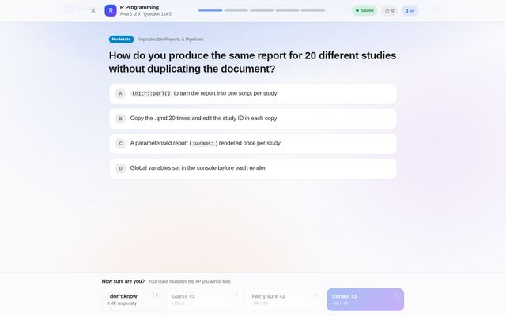](img/full/format-qs-shiny.jpg) Graded on the server: "Saved" indicator, resume codes | [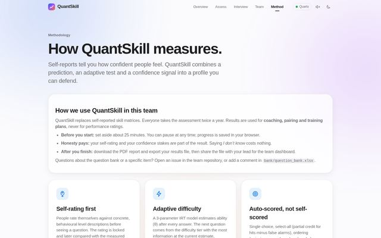](img/full/format-qs-quarto.jpg) The team's own Markdown on the Method page | [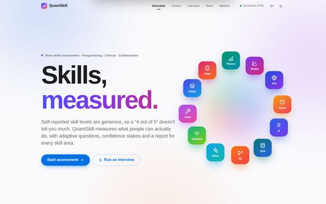](img/full/format-qs-html.jpg) One offline file ("Standalone HTML") |

*Click a picture to expand it.* QuantSkill and lumenJourney's study story already follow this model.
This document turns it into requirements for every Taiga project and states the status of each app.

---

## 1. Reference implementations

Every Taiga app is a reference for at least one format. A picture marked **Planned** is a format that
is specified (with a plan in §5.1) but not built yet.

### 1.1 Lumen

| App | Shiny | Quarto | Standalone HTML |
|---|---|---|---|
| **QuantSkill** |  |  |  |
| **lumenJourney** (study story) | [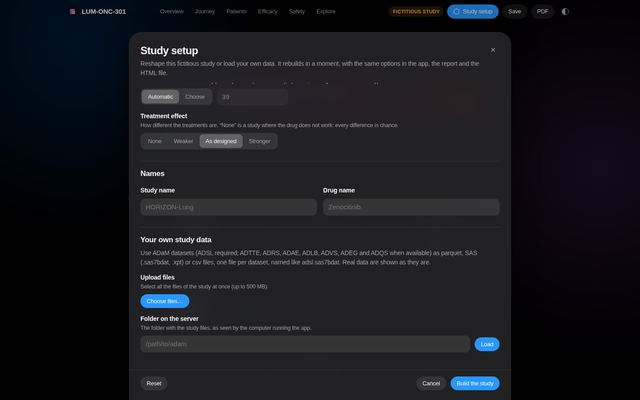](img/full/format-ls-shiny.jpg) | [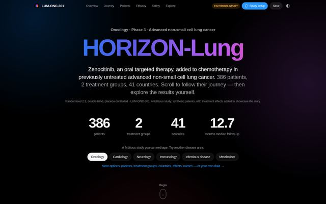](img/full/format-ls-quarto.jpg) | [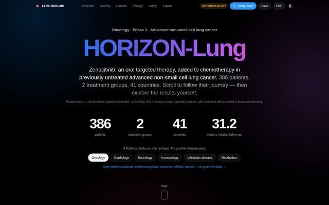](img/full/format-ls-html.jpg) |
| **DirectoR** | [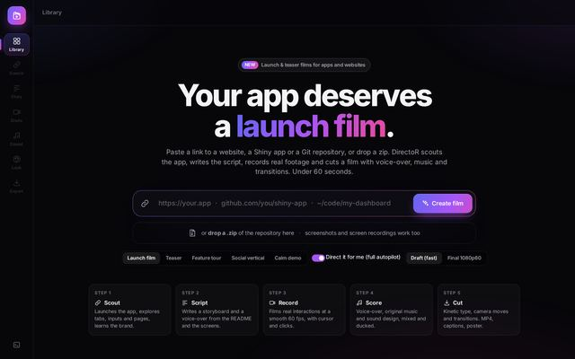](img/full/DirectoR-01-library.jpg) | [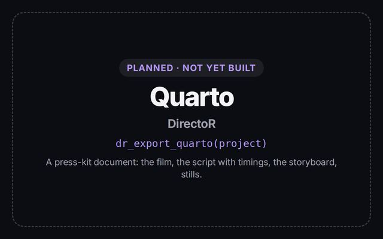](img/full/planned-DirectoR-quarto.jpg) | [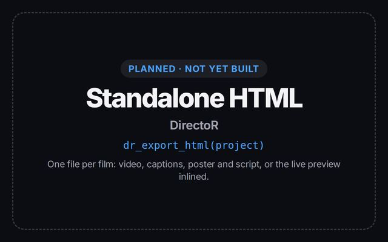](img/full/planned-DirectoR-html.jpg) |
| **RockShiny** | [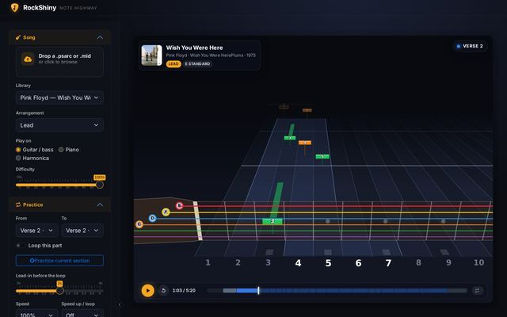](img/full/RockShiny-01-highway.jpg) | [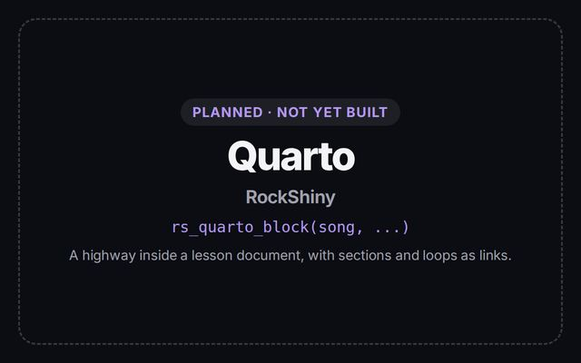](img/full/planned-RockShiny-quarto.jpg) | [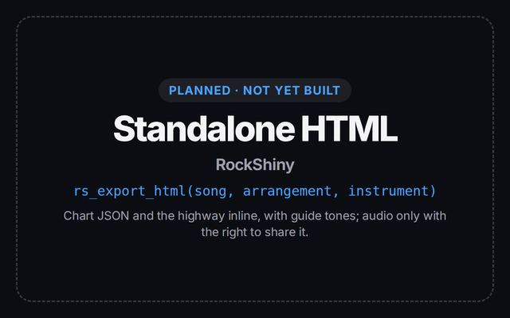](img/full/planned-RockShiny-html.jpg) |

- **QuantSkill**: `srcjs/` → `data-raw/build.{R,py}` → three targets from one source:
  `inst/app/www/quantskill.{js,css}` (Shiny), `inst/quarto/_quantskill-{head,body}.html` +
  `quantskill.qmd` (Quarto), `inst/html/quantskill.html` (standalone). R API: `run_app()`,
  `quantskill_app()`, `qs_export_quarto()`, `qs_export_html()`. The front end picks a **transport**
  (`srcjs/js/30-transport.js`): `LocalTransport` (HTML and Quarto: bank embedded, graded in the browser)
  or `ShinyTransport` (bank sent *without* answer keys, every answer graded and stored server-side, over a
  request/response protocol: `input$qs_msg` ↔ custom message `qs-msg`; see §2.2).
- **lumenJourney story**: `story_html(data, standalone, mode = c("html", "shiny", "quarto"))` builds
  the same fragment for every host (root `
`, inline CSS, JSON data
  and profiles in `<script type="application/json">`, inline JS). R API: `export_story_html()`,
  `run_story()`, `story_quarto()` / `story_quarto_block()`, plus `export_story_pdf()`. A Shiny bridge
  (`inst/story/lumen-story-shiny.js`) adds uploads and server folders (shown in the Shiny picture).
- **DirectoR** is the reference for a **Shiny studio**: an app shell (`R/ui.R`, `director.css/js`) whose
  custom inputs and `dr-*` custom messages drive a long-running engine through jobs. Its Quarto and HTML
  formats will carry the *films* it makes (§5.1).
- **RockShiny** is the reference for a **custom Shiny output binding**: the note highway
  (`inst/highway/binding.js`) is dependency-free JavaScript fed by chart JSON (`chart_json()`), driven by
  `rs-highway` messages. The same binding and JSON can be inlined into a standalone file or a Quarto block
  (§5.1).

### 1.2 Neue

| App | Shiny | Quarto | Standalone HTML |
|---|---|---|---|
| **teal_neue** | [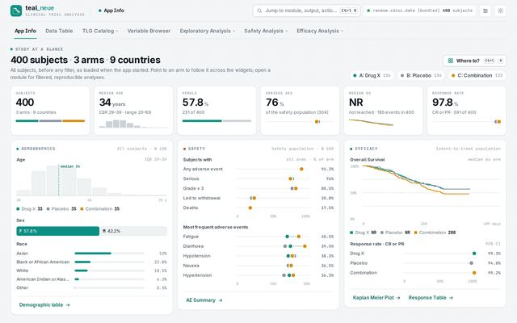](img/full/teal_neue-01-home.jpg) | [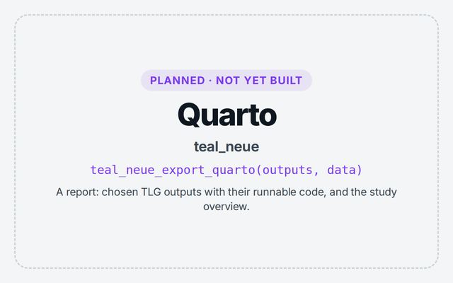](img/full/planned-teal_neue-quarto.jpg) | [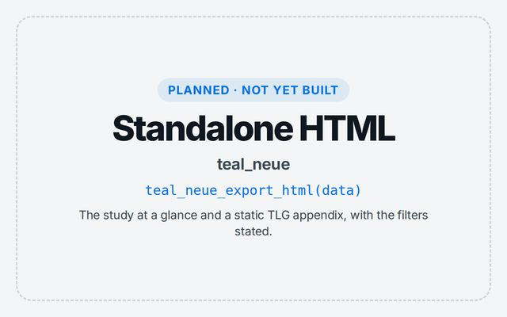](img/full/planned-teal_neue-html.jpg) |
| **BlockR** | [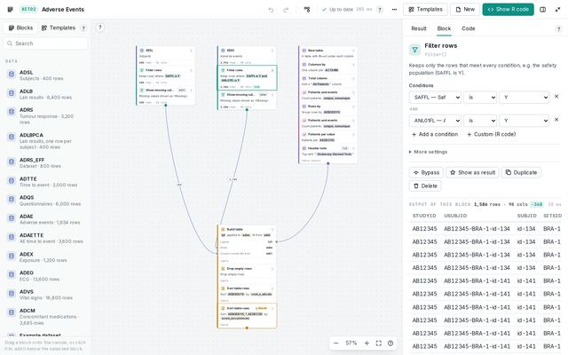](img/full/BlockR-01-canvas-template.jpg) | [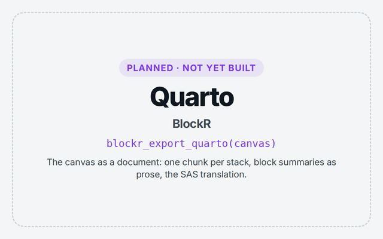](img/full/planned-BlockR-quarto.jpg) | [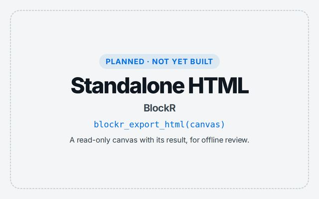](img/full/planned-BlockR-html.jpg) |

- **teal_neue** is the reference for a **layer over a host framework**: teal's Shiny app with a header,
  command bar and overview added through one `htmlDependency` (`teal_neue.css/js`) and an index travelling
  as JSON in the page. The study overview is computed in R (`R/overview.R`) and drawn in the browser, so it
  can be exported as is. Every TLG output has runnable code for a Quarto report (§5.1).
- **BlockR** is the reference for an **editor that round-trips code**: the canvas (`blockr_canvas.js`,
  plain JavaScript) exchanges a graph and block statuses with R (`blockr-graph`, `blockr-status`), and
  `blockr_compile()` writes the canvas back as R (and SAS). The canvas runs without Shiny, given a graph and
  a status (§5.1).

*The Shiny pictures of DirectoR, RockShiny, teal_neue and BlockR come from test benches built from each
app's own UI code (see `VERIFICATION.md` in the package sources). QuantSkill's Quarto picture is the render
shipped in its `quarto/` folder (Quarto 1.9.38, front end v2.0.0). lumenJourney's Quarto picture is
`inst/quarto/lumen-story.html`: by design, it looks like the HTML file.*

## 2. Architecture

### 2.1 One front end, three hosts

[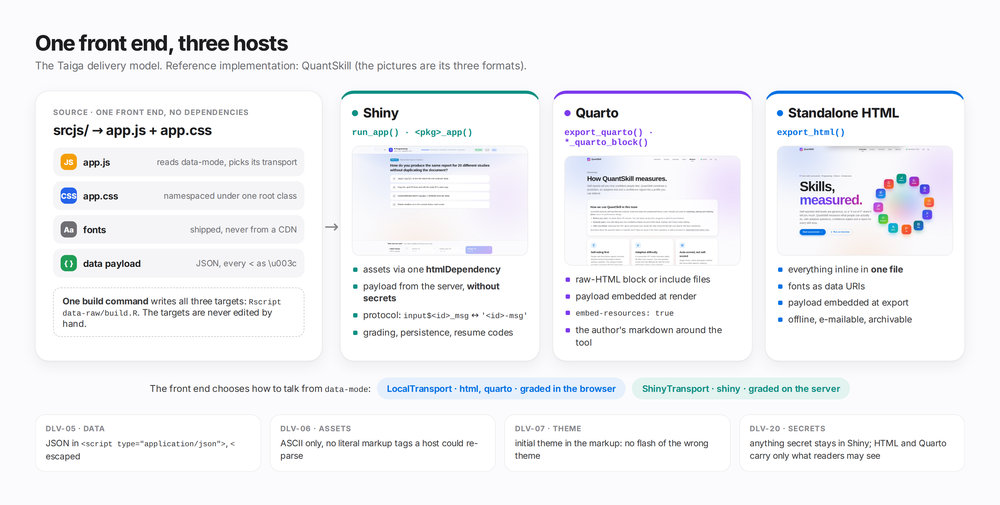](img/full/diagram-architecture.jpg)

One source (`app.js`, `app.css`, fonts, a JSON payload) is built by one command into three targets. The
front end reads `data-mode` and picks its transport: in HTML and Quarto it works alone in the browser,
and in Shiny it talks to the server. The rules that make one front end safe in every host (DLV-05, DLV-06,
DLV-07, DLV-20) are listed in §3. The taiga package implements them: `taiga_fragment()`,
`taiga_export_html()`, `taiga_export_quarto()`, `taiga_shiny_app()`, `taiga_json_script()`,
`taiga_check_assets()`.

### 2.2 The Shiny host: one input, one custom message

[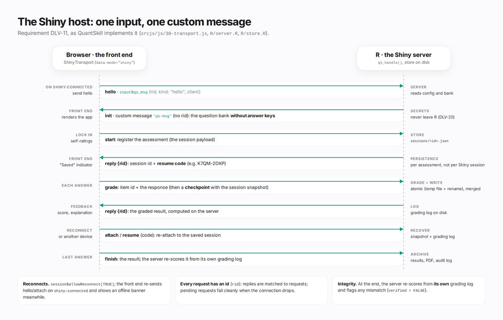](img/full/diagram-shiny-protocol.jpg)

## 3. Requirements

### 3.1 Front end

| ID | Requirement |
|---|---|
| DLV-01 | There is **one** front-end source (JS/CSS), built to all three targets by one build script. The three targets are never edited by hand. |
| DLV-02 | The front end has **no external requests**: no CDN, web fonts or analytics. Fonts ship in the package and are inlined as data URIs in the HTML target. |
| DLV-03 | All styles are **namespaced** under one root class (`.qs`, `.lumen-story`, `.tn-*`, `.bk-*`) so the front end can live inside a Quarto or Shiny page without leaking styles. Host-page resets are scoped (`html.qs-host`). |
| DLV-04 | The front end detects its host from `data-mode` (or an equivalent) and degrades per §4. It never assumes a server. |
| DLV-05 | Data is embedded as JSON in `<script type="application/json" id="…">` with every `<` written as `\u003c`, so no host (browser, pandoc, Quarto) can read markup in the data. |
| DLV-06 | Assets are **ASCII only** (other characters as `\u` escapes) and contain no literal `<script`, `</body>` or `<!--`. Hosts such as pandoc re-parse inline scripts. Build such strings from pieces. (lumenJourney enforces this in `tests/testthat/test-story.R`.) |
| DLV-07 | The initial theme is set in the markup (`data-theme`, or a head script run before first paint), so no host shows a flash of the wrong theme. |

### 3.2 Hosts and R API

| ID | Requirement |
|---|---|
| DLV-10 | **Shiny:** `run_app(...)` starts the app and `<pkg>_app(...)` returns a `shinyApp` for deployment. `app.R` in the package root is the deployment entry point. Assets come through one `htmlDependency`. |
| DLV-11 | **Shiny protocol:** client → server over one input (`input$<id>_msg`, JSON with a request id), server → client over one custom message (`<id>-msg`). It must survive reconnects (`session$allowReconnect(TRUE)`, re-attach on `shiny:connected`). |
| DLV-12 | **Quarto:** `export_quarto(dir, ...)` (or `<pkg>_quarto()`) writes a ready-to-render `.qmd` and its include files. A `*_quarto_block()` returns a raw-HTML block for authors who write their own `.qmd`. The document renders with `embed-resources: true`. |
| DLV-13 | **HTML:** `export_html(file, ...)` writes one self-contained file and returns its path invisibly. Opening it needs only a browser. |
| DLV-14 | The same options (data source, setup, theme) are accepted by all three entry points, with the same names. |

### 3.3 Security and capability

| ID | Requirement |
|---|---|
| DLV-20 | Anything that must stay secret (answer keys, credentials, unpublished data) is **Shiny-only**. The HTML and Quarto targets carry only what the reader may see. (QuantSkill's README warns that HTML/Quarto contain the answer keys.) |
| DLV-21 | Each project documents a **capability matrix** (§4): what each format can and cannot do. |
| DLV-22 | Third-party content (for example song audio in RockShiny, or licensed data) is never embedded in the portable formats without the right to redistribute it. |

### 3.4 Verification

| ID | Requirement |
|---|---|
| DLV-30 | CI builds all three targets and runs a headless smoke test on each (page loads, no console errors, the main view renders). |
| DLV-31 | Engine parity: logic that runs both in R and in the browser is tested for identical results (QuantSkill: `tests/testthat/fixtures/engine_cases.json`; lumenJourney: `tools/story-dev/check-stats.mjs`). |
| DLV-32 | Feature screenshots are regenerated from the built targets (`docs/features/`, with a `manifest.json` recording provenance). |

## 4. Capability matrix template

| Capability | Shiny | Quarto | HTML |
|---|---|---|---|
| Runs without a server | – | ✓ (rendered page) | ✓ |
| Server-side computation / secrets | ✓ | – | – |
| Persistence across sessions and devices | ✓ (server) | browser only | browser only |
| Uploads / reading server folders | ✓ | – (browser file pickers only) | – (browser file pickers only) |
| Author commentary around the tool | – | ✓ | – |
| Works offline / e-mailable | – | if `embed-resources` | ✓ |

---

## 5. Status by project

| Project | Shiny | Quarto | HTML | Notes |
|---|---|---|---|---|
| QuantSkill | ✓ `run_app()`, `quantskill_app()` | ✓ `qs_export_quarto()`, `inst/quarto/` | ✓ `qs_export_html()`, `inst/html/quantskill.html` | Reference implementation. Secure grading in Shiny only. |
| lumenJourney, study story | ✓ `run_story()` | ✓ `story_quarto()`, `story_quarto_block()` | ✓ `export_story_html()` (+ PDF) | Reference implementation. The analyst **teal app** (`run_app()`) is Shiny-only, by nature. |
| DirectoR | ✓ `run_app()` (studio) | **gap** | **gap** | Outputs today are MP4/SRT/poster files. |
| RockShiny | ✓ `shiny::runApp()` | **gap** | **gap** | The highway is already dependency-free JS fed by chart JSON. |
| teal_neue | ✓ `run_app()` (teal) | **gap** | **gap** | The overview is already JSON → plain HTML/SVG. TLG outputs come with runnable code. |
| BlockR | ✓ `run_app()` (teal) | **gap** | **gap** | The canvas editor is plain JS. `blockr_compile()` gives complete R (and SAS) code. |

### 5.1 Plans for the gaps

Each plan reuses what the app already has. None requires a rewrite.

**DirectoR**
- *HTML:* `dr_export_html(project)`: one file per film with the film, captions (SRT → WebVTT
  `<track>`), poster, script and storyboard. A lighter variant inlines the engine's existing live
  preview (`preview.html`: stage + timeline + proxies) so the film plays without an MP4.
- *Quarto:* `dr_export_quarto(project)`: a "press kit" `.qmd` with the film (``), the
  voice-over script with timings, the storyboard as a table, and stills (`python -m director stills`).

**RockShiny**
- *HTML:* `rs_export_html(song, arrangement, instrument)`: chart JSON (`chart_json()`) + `inst/highway/`
  assets inline. It plays with guide tones (synthesised in the browser). The song audio is included
  only if the user has the right to redistribute it (DLV-22). Microphone scoring works in the browser;
  personal bests stay in `localStorage`.
- *Quarto:* `rs_quarto_block(song, …)`: a highway block inside a lesson document (practice notes,
  loops and sections as links that seek the player).

**teal_neue**
- *HTML:* `teal_neue_export_html(data)`: the **study at a glance** page (`teal_neue_overview()` JSON +
  the overview widgets from `teal_neue.js`) plus a static TLG appendix (`rtables::as_html()` tables,
  PNG graphs), with the filters stated.
- *Quarto:* `teal_neue_export_quarto(outputs, data)`: a report `.qmd` with one section per chosen TLG
  output, its **runnable code** (what "Show R code" gives) as chunks, and the overview as a raw-HTML block.

**BlockR**
- *HTML:* `blockr_export_html(canvas)`: a **read-only canvas** (`blockr_canvas.js` runs without Shiny,
  given the graph and a status payload) with the result rendered in, so reviewers can inspect every
  block offline.
- *Quarto:* `blockr_export_quarto(canvas)`: the canvas as a `.qmd`, with one chunk per stack from
  `blockr_compile()`, block summaries as prose, and optionally the SAS translation (`blockr_sas()`) as
  a non-executed chunk for double programming.

Acceptance for every plan: DLV-01 to DLV-32, and a "Delivery formats" table in the project's README
(status, entry points, capability matrix).
