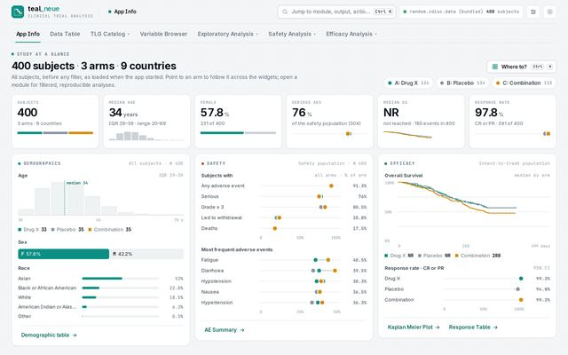
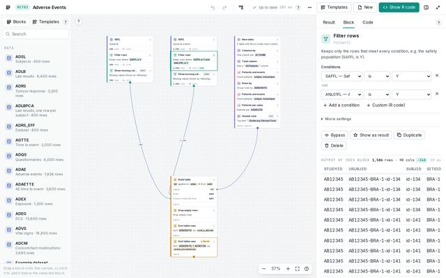
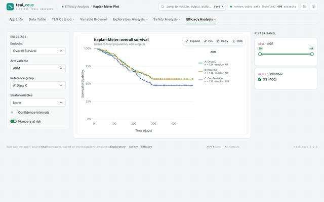
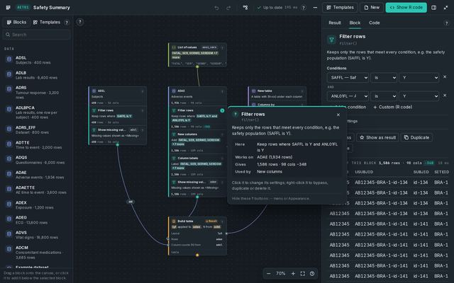
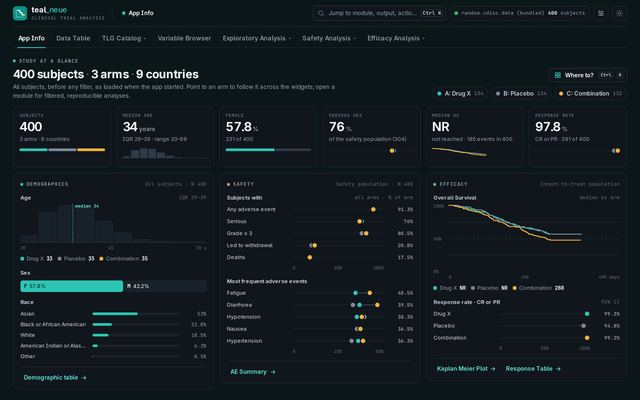
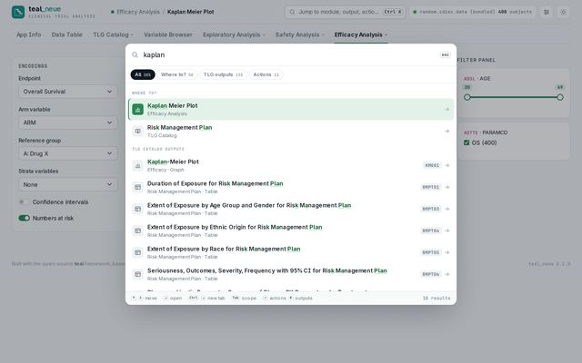
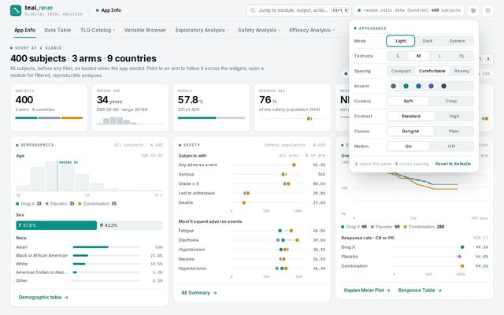

# Neue: styleguide

**Neue** is the Taiga framework for *working* tools: minimalist, high-density enterprise interfaces
where analysts spend hours. The look is "instrument": ruled white panels on a dot-grid canvas, one
accent, mono for identifiers and numbers. It is layered over an existing Bootstrap 5 / bslib theme (here,
teal's) by redefining CSS variables. It does not replace the theme.

| App | What it is | Canonical stylesheet(s) | Default theme |
|---|---|---|---|
| **teal_neue** 0.2.0 (`teal.neue`) | Clinical trial analysis (58 teal modules, TLG Catalog, study overview) | `inst/www/teal_neue.css`, `tlg_catalog.css` | Light; ink-blue dark |
| **BlockR** 0.1.3 | Drag-and-drop TLG builder (canvas of blocks) on the same app shell | `inst/www/blockr.css`, `blockr_canvas.css`, `tlg_catalog.css` | Light; lifted-slate dark |

BlockR carries teal_neue's token system (`--tn-*`, 47 root, 64 light and 79 dark properties). It adds a
canvas layer (`--bk-*`) and one deliberate change, its dark palette (§2.3). Numbers here come from
`tools/extract_tokens.py` (teal_neue: 598 custom properties, BlockR: 627) and `tools/contrast_audit.py`.
A starter token sheet for new projects is in [`neue-tokens.css`](../../css/neue-tokens.css).

---

## 1. Principles

1. **Density with calm.** Body text is 14 px (`--tn-fs-md .875rem`), controls are 34 px, and table cells
   are `.5rem .7rem`. The screen holds a lot, but every panel is ruled, aligned and quiet. Users can trade
   density for room (§5).
2. **One accent.** Teal `#0e8f83` (dark `#2cc5b4`) is the only colour that means "act here". Signal
   amber marks attention, and danger red and ok green are semantic. Section tints are the only other
   colours in the chrome, and they are quiet.
3. **Type does the structure.** Inter (or the system sans) is for reading. JetBrains Mono is for dataset
   names (`ADSL`), IDs (`AET01`), variable names and figures. Caps with +.08em tracking mark panel
   eyebrows.
4. **No decoration without function.** There is no glass (zero `backdrop-filter` declarations in either
   app) and almost no gradients (4 in teal_neue, 8 in BlockR). Shadows are hairline-soft. The only
   exuberant element is BlockR's Tutorial button, on purpose.
5. **Keyboard first.** A command bar (`Ctrl/Cmd+K`), single-key shortcuts, deep links and history for
   every view, and a shortcut sheet (`?`).
6. **Layer, don't fork.** Redefine Bootstrap's variables (`--bs-*`) from Neue tokens. There is no Sass
   compilation at start-up and no third-party requests: fonts, icons and scripts ship with the app.
   Setting `options(teal_neue.style = FALSE)` gives back the plain framework look.
7. **Plots are paper.** Server-rendered plots stay white in dark mode, so the screen matches the R code
   that produced them.

### Gallery

*Click a picture to expand it.*

| | |
|---|---|
| [](../img/full/teal_neue-01-home.jpg) teal_neue: study at a glance | [](../img/full/BlockR-01-canvas-template.jpg) BlockR: a template as blocks |
| [](../img/full/teal_neue-03-analysis-module.jpg) Module: tint, tools on hover, filter panel | [](../img/full/BlockR-09-dark-explain.jpg) BlockR: lifted-slate dark |
| [](../img/full/teal_neue-02-home-dark.jpg) teal_neue: ink-blue dark | [](../img/full/teal_neue-04-command-bar.jpg) Command bar |

---

## 2. Colour

### 2.1 Token architecture

Neue tokens come in five layers, each redefined by one attribute on `<html>`:

```
html:root                               primitives that do not change with the theme: type scale, spacing, radii, motion, section tints
html:not([data-bs-theme="dark"])        light semantic tokens  (--tn-canvas, --tn-panel*, --tn-line*, --tn-ink*, --tn-accent*, arms…)
html[data-bs-theme="dark"]              dark semantic tokens   (same names)
  └─ Bootstrap bridge                   --bs-body-bg, --bs-body-color, --bs-primary*, --bs-link-*, --bs-border-*, --bslib-sidebar-bg …
html[data-tn-section="safety"] …        section accent (when the user has not picked an accent)
html[data-tn-accent|text|density|corners|contrast|canvas]   user appearance overrides
```

Components read only semantic tokens (`var(--tn-panel)`), never hex values. BlockR's canvas tokens
map to them with fallbacks (`--bk-panel: var(--tn-panel, #fff)`), so the canvas works inside or
outside the shell.

### 2.2 Semantic palette

| Token | Light | Dark: teal_neue "ink-blue" | Dark: BlockR "lifted slate" |
|---|---|---|---|
| `--tn-canvas` (dot-grid page) | `#f3f5f6` | `#090d11` | `#151b21` |
| `--tn-dot` | `rgba(15,23,32,.085)` | `rgba(255,255,255,.06)` | `rgba(255,255,255,.09)` |
| `--tn-panel` / `-2` / `-3` | `#ffffff` / `#f8fafa` / `#eef2f3` | `#10161b` / `#0d1317` / `#182129` | `#1e262e` / `#1a2128` / `#29333d` |
| `--tn-line` / `-strong` | `#e2e7ea` / `#cbd3d9` | `#1f2932` / `#2e3b46` | `#303c47` / `#46545f` |
| `--tn-ink` … `-4` | `#0f1720` `#3a4651` `#66737f` `#95a1ab` | `#eef3f6` `#c6d1d9` `#8d9ca8` `#5e6e7a` | `#f2f6f8` `#d5dee5` `#a7b4be` `#808f9b` |
| `--tn-accent` / `-ink` / `-soft` | `#0e8f83` / `#0a6f66` / `#e2f3f0` | `#2cc5b4` / `#62e0d1` / `rgba(44,197,180,.13)` | same as teal_neue |
| `--tn-on-accent` | `#ffffff` | `#03201c` | `#03201c` |
| `--tn-signal` / `-soft` | `#d98b0b` / `#fff3dc` | `#f2b33d` / `rgba(242,179,61,.14)` | same |
| `--tn-danger` · `--tn-ok` | `#c8372f` · `#1f9d57` | `#f06b62` · `#3fcf7f` | same |
| `--tn-code-bg` / `-ink` | `#0f1720` / `#dde6ec` | `#070a0d` / `#dde6ec` | `#11171c` / `#dde6ec` |
| `--tn-scrim` | `rgba(15,23,32,.32)` | `rgba(0,0,0,.6)` | `rgba(0,0,0,.6)` |

### 2.3 Two dark palettes: pick one per product

- **Ink-blue (teal_neue).** Deep and low-glare, for long reading sessions with white-paper plots. The
  canvas is almost black.
- **Lifted slate (BlockR).** Panels are about +8 L* lighter (`#1e262e` vs `#10161b`), lines and ink are
  lifted, shadows are softer. It suits a canvas with many small coloured blocks and wires, where a near-black ground makes
  colours vibrate.

Both keep the same accent, signal and semantic colours. Never mix the two inside one product.

### 2.4 Section tints and categorical palettes

| Section (`--tn-sec-*`) | Light | Dark | Also sets `--tn-accent` when no accent is chosen |
|---|---|---|---|
| home | `#0e8f83` | `#2cc5b4` | – |
| explore | `#3a62c9` | `#7d9cf2` | yes |
| safety | `#b4572c` (terracotta) | `#ec8d62` | yes |
| efficacy | `#2b8753` | `#55c98b` | yes (teal_neue only) |
| catalog | `#7650b6` | `#b497f2` | yes |

**Arms** (`--tn-arm-0…5`, `-n`): `#0e8f83` `#d98b0b` `#4a67b0` `#a34f8f` `#6f8a2e` `#b5533c` · `#8a96a1`
(dark: `#2cc5b4` `#f2b33d` `#86a3f0` `#dd86c8` `#a9c95b` `#ec8a6e` · `#7b8a96`). Used by the overview
widgets. Pointing at an arm highlights it in every widget.

**Block categories** (BlockR `--bk-c-*`): data `#4a67b0`, prep `#0e8f83`, layout `#7a5cc2`,
analyze `#a34f8f`, output `#c27a06`, plot `#c4553f`, value `#6f8a2e`, code `#5f6c78` (each lifted in
dark). A block shows its category as a 3 px left rule and an icon tile, and wires take the colour of the
kind of value they carry (`--bk-wk-*`). Tutorial levels: beginner `#1f9d57`, intermediate `#c27a06`,
advanced `#c8372f`.

### 2.5 Contrast rules (from `inst/extdata/tokens/contrast.md`)

| Pair (light) | Ratio | Rule |
|---|---|---|
| `--tn-ink` on panel / canvas | 18.05 / 16.50 | Headings, data. |
| `--tn-ink-2` on panel / canvas | 9.66 / 8.83 | Body text, labels. |
| `--tn-ink-3` on panel / canvas | 4.86 / **4.44** | Secondary text on panels. On the canvas, only at ≥ 14 px and 600 weight, or large. |
| `--tn-ink-4` on panel / canvas | **2.64 / 2.41** | Fails AA. Use for disabled states, placeholders, dividers and decorations only, never for information. |
| `--tn-on-accent` on `--tn-accent` | **3.98** | AA for large or bold UI only. Filled-button labels must be ≥ 14 px semibold, and the accent-ink `#0a6f66` is the darker option. |
| High contrast (`data-tn-contrast="high"`) | ink-2 `#141c24`, ink-3 `#36414b`, ink-4 `#56626d`, lines `#bcc5cc` | The user switch for low vision: ink-4 becomes ≥ 6:1. |

In dark mode every ink level passes 3:1, and ink 1 to 3 pass 4.5:1 (ink-4 on panel 3.46).

---

## 3. Typography

| Token | Value | Use |
|---|---|---|
| `--tn-font-sans` | `-apple-system, BlinkMacSystemFont, "Inter", "Segoe UI Variable Text", "Segoe UI", Roboto, "Helvetica Neue", Arial` | All UI and reading (Inter ships with the app). |
| `--tn-font-mono` | `"JetBrains Mono", ui-monospace, "SF Mono", SFMono-Regular, Menlo, Consolas, "Liberation Mono"` | Dataset names, IDs, variable names, figures, status, version, code. |
| `--tn-fs-2xs` … `2xl` | `.6875 / .75 / .8125 / .875 / 1 / 1.25 / 1.625rem` (11 / 12 / 13 / **14** / 16 / 20 / 26 px) | Body is `md` (14 px). Titles are 20–26 px. There are no display sizes. |
| `--tn-track-tight` / `--tn-track` / `-mono` / `-caps` | `−.018em` / `−.006em` / `+.02em` / `+.08em` | Headings / body / mono / caps eyebrows. |
| Line height | 1.5 (body) | |

Text size is a user setting. `data-tn-text="s|l|xl"` rescales the whole `--tn-fs-*` scale (for example,
`l` sets md to .9375rem and 2xl to 1.75rem). Components must use the tokens, not px.

Patterns: **panel eyebrow** (`STUDY AT A GLANCE`, `FILTER PANEL`, `ENCODINGS`) in 11–12 px mono or
sans caps, +.08em, ink-3, with a 6 px square in the section tint. **Figures** (overview tiles) are
26–28 px, 700, tight tracking, with the unit in small ink-3. **Dataset chips** are mono, for example
`ADSL · AGE` with `ADSL` in mono and accent-ink.

---

## 4. Space, shape, elevation

| Token | Comfortable (default) | Compact | Roomy |
|---|---|---|---|
| `--tn-s1 … s3` | 4 / 8 / 12 px | (unchanged) | (unchanged) |
| `--tn-s4 / s5 / s6 / s8` | 16 / 20 / 24 / 32 px | 12 / 14 / 16 / 22 | 20 / 26 / 32 / 40 |
| `--tn-control-h` | 34 px | 28 px | 38 px |
| `--tn-cell` | `.5rem .7rem` | `.28rem .55rem` | `.7rem .9rem` |

| Radius | Soft (default) | Crisp (`data-tn-corners="crisp"`) |
|---|---|---|
| `--tn-r-sm / r / r-lg / r-xl` | 6 / 8 / 12 / 14 px | 2 / 3 / 4 / 6 px |

Elevation: three levels, all soft:

- `--tn-shadow-1: 0 1px 2px rgba(15,23,32,.05)` (panels at rest)
- `--tn-shadow-2: 0 1px 2px rgba(15,23,32,.06), 0 8px 24px -10px rgba(15,23,32,.16)` (popovers, hover)
- `--tn-shadow-3: 0 2px 4px rgba(15,23,32,.06), 0 24px 64px -16px rgba(15,23,32,.32)` (dialogs, command bar)

Panels are **ruled** (1 px `--tn-line`), not floating. The page canvas shows a dot grid
(`--tn-dot`), which the user can turn off (`data-tn-canvas="plain"`).

**BlockR layout tokens:** `--bk-pal-w 232px` (palette), `--bk-panel-w 420px` (right panel),
`--bk-block-w 264px` (a block). Below 1100 px the palette and panel become 204 / 340 px. The canvas is
at least `blockr.canvas_height` (default 85 %) of the window, and it has a full-screen mode.

---

## 5. Appearance system (user-controlled)

Everything a user can change is an attribute on `<html>`, read by CSS, saved in `localStorage`
(`teal_neue:appearance`, `teal_neue:color-mode`), and applied by an inline head script **before first
paint** (no flash):

| Attribute | Values | Effect |
|---|---|---|
| `data-bs-theme` | `light` · `dark` (mode: light, dark, auto) | Palette. Switching plays a circular reveal unless motion is off. |
| `data-tn-text` | `s` · (m) · `l` · `xl` | Type scale. |
| `data-tn-density` | `compact` · (comfortable) · `roomy` | Spacing, control height, table cells. |
| `data-tn-accent` | (section tint) · `teal` · `ocean` · `iris` · `graphite` | Accent (overrides the section tint). |
| `data-tn-corners` | (soft) · `crisp` | Radii. |
| `data-tn-contrast` | (standard) · `high` | Ink and lines. |
| `data-tn-canvas` | (dots) · `plain` | Page background. |
| `.tn-still` class | motion off | No animations (also from `prefers-reduced-motion`). |

[](../img/full/teal_neue-06-appearance.jpg)

---

## 6. Motion

`--tn-ease: cubic-bezier(.2,.8,.2,1)` (the same curve as Lumen), `--tn-fast 120ms`, `--tn-med 200ms`,
`--tn-slow 260ms`. Motion is functional only: overlays open, count-ups in the overview (900 ms),
curves drawing in, the dark-mode reveal, toasts, and the BlockR canvas arranging and wiring. Everything
stops under `.tn-still` or `prefers-reduced-motion` (teal_neue has 1 reduced-motion block, BlockR 3).

---

## 7. Components

### 7.1 The shell (both apps)

| Component | Classes | Notes |
|---|---|---|
| Header | `.tn-header` → `.tn-brand` (logo + `teal_neue` / sub "CLINICAL TRIAL ANALYSIS" in mono caps), `.tn-crumbs`, `.tn-actions` | The brand is a link home (`H`). The breadcrumb is filled by JS from the active tab chain. |
| Command field | `.tn-cmd` + `kbd.tn-cmd-key` ("Ctrl K") | Opens the command bar. |
| Status pill | `.tn-status` → `-dot` (live; amber while busy), `-source` (mono), `-figure` (`400 subjects`), `-time` ("ready 1.6 s") | Data provenance is always visible. |
| Icon buttons | `.tn-iconbtn` (appearance), `.tn-toggle` (light/dark) | 34 px square, ruled. |
| Tab rail | `.nav-underline` / `.nav-tabs` (teal's tabs) with dropdowns for module groups | Active tab: weight 620, 2 px inset underline in `--tn-accent` (the section tint unless the user picked an accent), with a sliding indicator. |
| Footer | `.tn-footer` → credits, `.tn-footer-keys` (`Ctrl K jump`, `? shortcuts`), `.tn-version` (mono) | |

### 7.2 Navigation and overlays

| Component | Classes | Behaviour |
|---|---|---|
| Command bar | `.tn-pal*` (scopes: All, Where to?, TLG outputs, Actions; results grouped; fuzzy highlight) | `Ctrl/Cmd+K` or `/`. Enter opens, Ctrl+Enter opens a new tab. |
| Where to? | `.tn-where*` | Every module nested by section, each with its tint. |
| Appearance panel | `.tn-appear*`, `.tn-seg`, `.tn-swatch` | Popover anchored to the header button. |
| Shortcut sheet | `.tn-keys*` | `?`. |
| Viewer / pins / compare | `.tn-viewer`, `.tn-tray`, `.tn-swipe`, `.tn-diff` | Expand a plot; pin versions; compare by swipe, side by side or difference. |
| Plot and table tools | `.tn-tools`, `.tn-tool` | Shown on hover: Expand, Pin, Copy, PNG / Copy for Excel, CSV. |
| Toasts | `.tn-toast(s)` | |

### 7.3 Content components

| Component | Classes | Notes |
|---|---|---|
| Overview (home) | `.tn-ov*` (148 rules): KPI tiles, mini histogram, sex bar, race bars, dot plots by arm, mini KM, response CI dots, arm legend chips | Computed once in R (`R/overview.R`), drawn in plain HTML/SVG. Every widget links to its module. |
| TLG Catalog | `.tn-tlg*`: sidebar (`-heading`, `-sub`, `-search`, `-list`, grouped `-item` with icon, mono ID and title), toolbar (`-chip-id`, `-chip-table`, title, actions), output, code dialog (`.tn-tlg-code`) | One page per topic; deep links `#/tlg-catalog/<topic>/<id>`. |
| Panels | Bootstrap `.card`, `.well`, `.accordion` restyled via `--bs-*` | Ruled, 8–12 px radius, shadow-1. |
| Filter panel | bslib sidebar (right), filter cards | Dataset names in mono. |

### 7.4 BlockR canvas (`.bk-*`, 117 roots)

| Component | Classes | Notes |
|---|---|---|
| Top bar | `.bk-top`: template chip (mono ID), editable title, undo/redo, arrange, run state ("Up to date · 41 ms", mono), `···`, Templates, New, **Show R code** (filled accent), panel toggle, full screen | |
| Palette | `.bk-palette`, `.bk-pal*`: Blocks / Templates tabs, search, groups (DATA, PREPARE, …), items with category icon tile | Drag onto the canvas, or click to add below the selection. |
| Stage | `.bk-stage` (dot grid, pan and zoom) | Zoom controls bottom-centre. |
| Block | `.bk-block.bk-cat-*.bk-state-*` → `-head` (icon, title, `?`), `-sum` (plain-language summary with `.bk-chip` values), `-foot` (mono `1,586 rows · 98 cols`, delta `-348`) | Stacks read top to bottom. The selected block has an accent ring. |
| Ports, sockets, wires | `.bk-port`, `.bk-socket`, `.bk-wire` (`.bk-wk-*` colours; row counts as labels; dashed = implicit) | |
| Right panel | `.bk-panel`: Result / Block / Code panes; inspector (`.bk-insp*`, condition rows, column tags); code (`.bk-code`, R/SAS switch, Edit, Copy, Download) | |
| Explain | `.bk-pop` "What is this?" (Here / Works on / Gives / Used by) | The `?` on every part of the page. |
| Add next | `.bk-add-next` → menu of recipes and steps | |
| Tutorial | `.bk-tutorial-btn` (gradient `#ff5f45 → #e93d8f → #7b4dff`), `.bk-coach*` lesson card, `.bk-level-*` | The only saturated gradient in Neue, on purpose. |

---

## 8. Data, tables and plots

- **Numbers** are mono or tabular, right-aligned in tables, with thousands separators (`1,586`).
- **Provenance** is always on screen: the status pill (source · subjects · last update) and output
  footers (`rows · cols`, time to compute).
- **Plots** use the app theme for ink only (`ink #0F1720` titles, `ink2 #3A4651` axis titles,
  `ink3 #66737F` labels, `ink4 #95A1AB` captions, via `teal_neue_ggplot2_args()`). Data colours stay
  with the analysis package (NEST palette). Fonts are **not** set inside plots, because that would break
  reproduction and PDF export on machines without the font. Plots stay white in dark mode.
- **Code** is always one click away ("Show R code", and SAS in BlockR). The code uses the filtered data
  and runs on its own.

---

## 9. Do and don't

| Do | Don't |
|---|---|
| Redefine `--bs-*` from `--tn-*`. Keep the host framework recognisable. | Compile a custom Bootstrap theme at start-up, or fork the framework CSS. |
| Use mono for every identifier, dataset, variable, ID and count. | Use mono for prose or labels. |
| Keep the accent for actions and focus, and tints for sections. | Introduce a second accent, gradients or glass. |
| Size with `--tn-fs-*`, `--tn-s*` and `--tn-control-h` so appearance settings work. | Hard-code px sizes in components. |
| Give every view a deep link and a keyboard path. | Hide features behind hover only (pins, code and links also have keys: `P`, `C`, `L`). |
| Keep `--tn-ink-4` for non-essential text. | Put information in ink-4 or on the dot canvas in ink-3. |
| Pick *one* dark palette (ink-blue or lifted slate). | Mix them, or darken plots in dark mode. |
